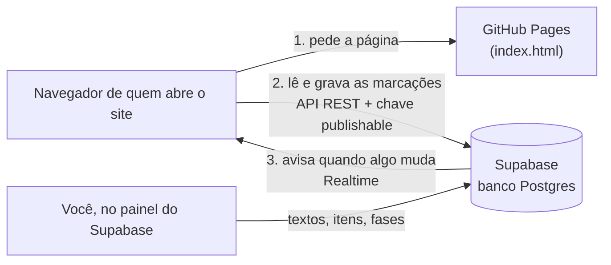
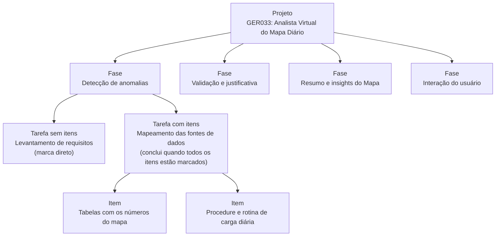
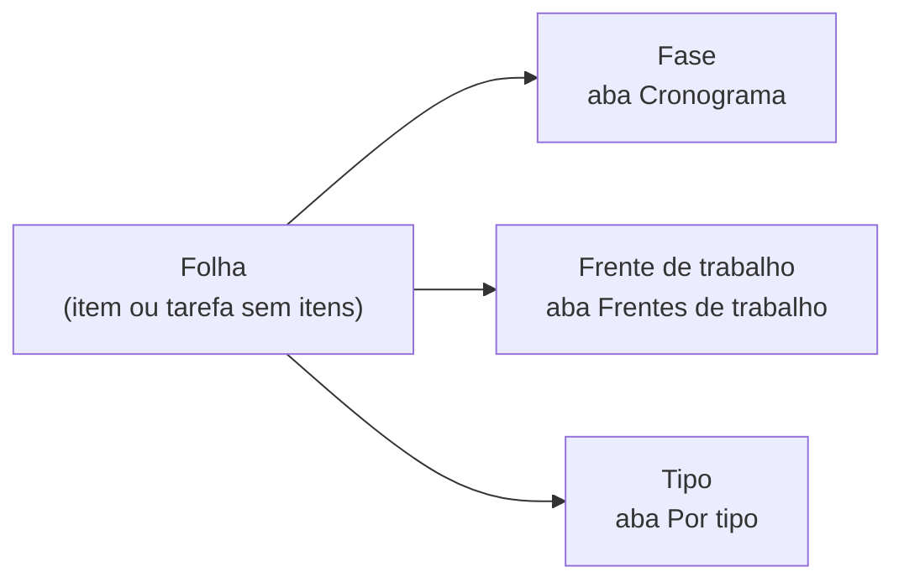
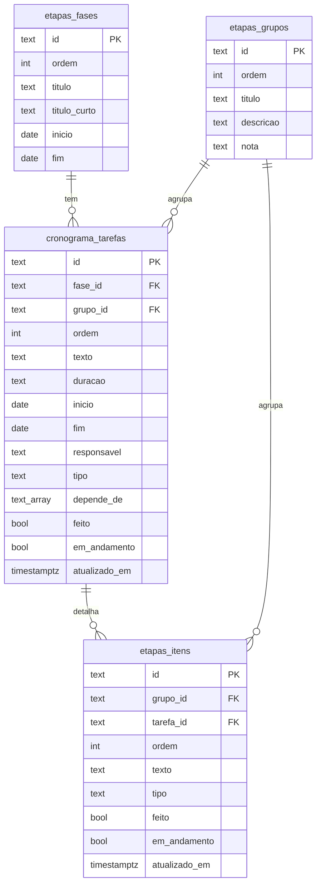

# Site de etapas de projeto: guia completo

Este guia explica, do zero, como o site de etapas do GER033 foi feito e como repetir tudo num projeto novo. Você pode seguir os passos à mão ou usar um dos caminhos automáticos: o **gerador** (uma página que converte o cronograma do MS Project) ou um **prompt pronto para o Claude**.

- Site do GER033 no ar: https://kevo-br.github.io/etapas-ger033/
- Gerador: https://kevo-br.github.io/etapas-ger033/modelo/gerador.html
- Repositório: https://github.com/kevo-br/etapas-ger033

## Índice

1. [O que é o site](#1-o-que-é-o-site)
2. [Como as peças se encaixam](#2-como-as-peças-se-encaixam)
3. [Organograma: como a informação se organiza](#3-organograma-como-a-informação-se-organiza)
4. [Regras que o site aplica](#4-regras-que-o-site-aplica)
5. [Banco de dados (Supabase)](#5-banco-de-dados-supabase)
6. [Layout](#6-layout)
7. [Arquivos da pasta](#7-arquivos-da-pasta)
8. [Preparar o cronograma no MS Project](#8-preparar-o-cronograma-no-ms-project)
9. [Projeto novo: caminho manual](#9-projeto-novo-caminho-manual)
10. [Projeto novo: caminhos automáticos](#10-projeto-novo-caminhos-automáticos)
11. [Manutenção do dia a dia](#11-manutenção-do-dia-a-dia)
12. [Problemas conhecidos e soluções](#12-problemas-conhecidos-e-soluções)
13. [Segurança](#13-segurança)
14. [Histórico do GER033](#14-histórico-do-ger033)

---

## 1. O que é o site

Uma página única, aberta por link, que mostra as etapas de um projeto para a equipe marcar o que já foi feito.

- **Três visões dos mesmos itens:** Frentes de trabalho (por assunto), Cronograma (fase → tarefa → item, com datas) e Por tipo (análise, desenvolvimento e validação). Os números batem sempre, porque é a mesma lista organizada de três jeitos.
- **Marcações compartilhadas:** quem marca um item grava no banco, e quem está com a página aberta vê a mudança sem recarregar.
- **Leitura rápida do andamento:** percentual concluído do projeto e de cada fase, frente e tipo; itens em andamento; atrasos que levam em conta as dependências entre tarefas.
- **Filtros:** fase, tipo e situação (todos, pendentes ou concluídos). Valem nas três abas.

## 2. Como as peças se encaixam



- **GitHub Pages** só entrega o arquivo `index.html`. Ele não guarda dado nenhum e não roda nada no servidor.
- **Supabase** é um banco Postgres na nuvem que já vem com uma API pronta. O navegador conversa direto com ele, sem você escrever um servidor.
- O site usa a **chave publishable**, que é pública por natureza. Quem protege os dados são as **regras dentro do banco** (RLS e permissão por coluna, seção 13).
- O site inteiro é **um arquivo só** (`index.html`): visual, lógica e configuração. A biblioteca do Supabase vem de um CDN.

## 3. Organograma: como a informação se organiza

### 3.1 A árvore do cronograma

É a mesma estrutura de tópicos do MS Project: o projeto tem fases, as fases têm tarefas e as tarefas podem ter itens de detalhe.



### 3.2 O que se marca: as "folhas"

O que tem checkbox próprio no site é a **folha** da árvore:

- **todo item de detalhe**;
- **toda tarefa sem itens**.

Uma tarefa com itens não é marcada direto: ela fica concluída quando todos os itens dela estão marcados. No GER033 são **46 folhas**: 24 itens e 22 tarefas sem itens.

### 3.3 As três organizações de cada folha

Cada folha pertence, ao mesmo tempo, a uma fase (pela tarefa), a uma frente e a um tipo. Cada aba agrupa as mesmas folhas por um desses três.



| Organização | O que é | No GER033 |
|---|---|---|
| **Fase** | Etapa do cronograma, com início e fim | 4 fases: Detecção de anomalias 26 folhas, Validação e justificativa 8, Resumo e insights 6, Interação do usuário 6 |
| **Frente de trabalho** | Assunto ou equipe; tem descrição e "por que falta" | 11 frentes, como Base de dados do mapa, Paipe: agente de IA, Testes e documentação |
| **Tipo** | Natureza do trabalho | Análise 10, Desenvolvimento 27, Validação 9 |

Além disso, cada folha tem responsável, datas (as da tarefa) e dependências (as predecessoras da tarefa).

## 4. Regras que o site aplica

### Percentuais

- **Toda folha vale o mesmo** no total do projeto. Com 46 folhas, cada uma vale cerca de 2,2%.
- O percentual que uma fase, frente ou tipo **vale** é o número de folhas dele dividido pelo total do projeto.
- O percentual **já concluído** é o número de folhas marcadas dividido pelo total do projeto.
- Com um filtro ativo, o resumo do topo diz quanto aquele recorte vale do projeto e quanto ele já entrega.

### Situação de um grupo (fase, frente ou tipo)

| Selo | Quando aparece |
|---|---|
| **Concluído** | todas as folhas marcadas |
| **Em andamento** | alguma folha marcada ou com o botão "Em andamento" ligado |
| **Pendente** | nenhuma folha marcada nem em andamento |
| **N atrasadas** | aparece no lugar do selo quando há folhas atrasadas |

### Em andamento, Aguardando e Atrasada

- **Em andamento:** cada folha ainda aberta tem um botão "Em andamento". Marcar a folha como concluída desliga o botão.
- **Aguardando:** a folha depende de uma tarefa (predecessora) que ainda não foi concluída. Enquanto isso, ela **não conta como atrasada**, mesmo com o prazo vencido. O site mostra o motivo, por exemplo "Aguardando: Configuração dos resumos comparativos".
- **Atrasada:** o prazo (término) passou, a folha não está concluída e todas as predecessoras já foram concluídas.

Exemplo do GER033: "Testes internos" da Detecção venceu em 30/06, mas depende de "Configuração dos resumos comparativos" (da Paipe), que ainda não foi concluída. Por isso aparece como "Aguardando", e o mesmo vale para toda a cadeia que vem depois dela.

### Filtros e marcação em lote

- **Fase** e **Tipo** ficam no painel "Filtros", que abre e fecha. Fechado, ele mostra o que está selecionado, em verde quando há algum filtro ativo.
- **Situação:** Todos, Pendentes ou Concluídos. Fica sempre visível, com os botões Expandir tudo e Recolher tudo.
- **Marcação em lote:** o checkbox de uma frente, fase, tipo ou tarefa com itens marca ou desmarca todas as folhas dela que estão no filtro atual de fase e tipo.

### Atualização e preferências

- Toda marcação grava na hora. Se outra pessoa marca algo, a página atualiza sozinha.
- "Última alteração" mostra a data e hora da mudança mais recente no banco. Depois de rodar um script, ela mostra o horário do script.
- A aba escolhida, os filtros e o que está aberto ficam guardados no navegador de cada pessoa, separados por projeto.

## 5. Banco de dados (Supabase)

### 5.1 Tabelas



| Tabela | Guarda | Colunas que merecem atenção |
|---|---|---|
| `etapas_fases` | as fases do cronograma | `titulo_curto` é o texto do botão de filtro |
| `etapas_grupos` | as frentes de trabalho | `nota` é o "Por que falta", que aparece enquanto a frente não termina |
| `cronograma_tarefas` | as tarefas de cada fase | `grupo_id` é a frente; `depende_de` lista os ids das predecessoras; `tipo` aceita `analise`, `desenvolvimento` ou `validacao` |
| `etapas_itens` | os itens de detalhe | `tarefa_id` é a tarefa onde o item fica pendurado; `grupo_id` é a frente |

### 5.2 Regras do banco

- **RLS (Row Level Security)** ligado nas quatro tabelas, com políticas que deixam todos lerem e fazerem update em tarefas e itens.
- **Permissão por coluna:** o papel `anon` (quem usa a chave publishable) só pode alterar `feito` e `em_andamento`. Tentar mudar um texto dá "permission denied".
- **Gatilho de horário:** antes de cada update, o banco grava `now()` em `atualizado_em`. Assim a data da última alteração não depende do relógio de quem marcou.
- **Tempo real:** as quatro tabelas estão na publicação `supabase_realtime`, que avisa os navegadores conectados.

O arquivo [`modelo/schema.sql`](modelo/schema.sql) cria tudo isso de uma vez num projeto novo. No GER033, a mesma estrutura foi criada aos poucos, pelos quatro scripts da raiz (seção 14).

## 6. Layout

### 6.1 Estrutura da página, de cima para baixo

```
┌─────────────────────────────────────────────────────────┐
│ RÓTULO DO PROJETO                                        │
│ Etapas do projeto                       ← título         │
│ Descrição em uma ou duas frases                          │
├─────────────────────────────────────────────────────────┤
│ 17/46  itens concluídos · 37%                ← resumo    │
│ ███████████░░░░░░░░░░░░░░░░                              │
│ Projeto inteiro: 37,0% concluído. 3 atrasados.           │
│ ● Tudo salvo    Última alteração: 22/10/2026, 07:41      │
├─────────────────────────────────────────────────────────┤
│ Frentes de trabalho │ Cronograma │ Por tipo  ← abas      │
│ [FILTROS  Fase: Todas · Tipo: Todos              ›]      │
│ [Todos|Pendentes|Concluídos]   [Expandir][Recolher]      │
├─────────────────────────────────────────────────────────┤
│ › ☑ Base de dados do mapa      6,5%   3/3   CONCLUÍDO    │
│ ⌄ ▣ Paipe: agente de IA       34,8%  3/16   2 ATRASADAS  │
│     Vale 34,8% do projeto · 6,5% já concluído.           │
│     Descrição da frente                                  │
│     ┃ Por que falta: …                                   │
│     │ ☐ Item                       [Em andamento]        │
│     │   Fase · período · responsável · tipo · Aguardando │
├─────────────────────────────────────────────────────────┤
│ Rodapé com as regras de peso e de atraso                 │
└─────────────────────────────────────────────────────────┘
```

### 6.2 Componentes

| Componente | Como é |
|---|---|
| Cartão de grupo (frente, fase ou tipo) | Caixa com borda fina. Na linha: seta para abrir, checkbox de grupo (marcado, vazio ou "meio" quando parcial), título, percentual que vale, contagem `feitos/total` e selo de situação |
| Corpo do cartão | Frase "Vale X% do projeto · Y% já concluído", descrição, caixa amarela "Por que falta" e a lista de folhas com uma linha-guia à esquerda |
| Folha | Checkbox, texto, linha de detalhes (fase, período, responsável ou tarefa de origem, tipo, Aguardando ou Atrasada) e o botão "Em andamento" |
| Tarefa com itens (aba Cronograma) | Texto em negrito com os detalhes, contagem e percentual, e os itens dentro dela |
| Selos | Pílulas em maiúsculas: verde (Concluído), âmbar (Em andamento), cinza (Pendente) e vermelho (atrasadas) |
| Chips de filtro | Pílulas com borda; a escolhida fica verde |

### 6.3 Cores

As cores são variáveis CSS (tokens) no topo do `index.html`. O modo escuro é automático, conforme o sistema de quem abre.

| Token | Claro | Escuro | Uso |
|---|---|---|---|
| `--bg` | `#F3F6F4` | `#0E1412` | fundo da página |
| `--surface` | `#FFFFFF` | `#151D1A` | cartões e caixas |
| `--ink` | `#15201C` | `#E4ECE8` | texto principal |
| `--muted` | `#5A6963` | `#95A49E` | texto secundário |
| `--line` | `#D9E1DD` | `#27322E` | bordas e linhas-guia |
| `--accent` | `#1D7552` | `#4DC28E` | verde de concluído, barra de progresso e foco |
| `--warn` | `#9A6400` | `#E2A83C` | em andamento, aguardando, por que falta |
| `--bad` | `#B3261E` | `#F2847C` | atrasada e erros |

### 6.4 Fontes

Do Google Fonts, cada uma com uma alternativa caso não carregue:

- **Archivo** (600 e 800): título, números do placar e nomes de seção.
- **IBM Plex Sans** (400, 500 e 600): texto.
- **IBM Plex Mono** (500): rótulos em maiúsculas, datas, contagens e percentuais.

### 6.5 Tela pequena, acessibilidade e movimento

- A coluna tem no máximo 760 px. Abaixo de 480 px, os filtros ocupam a largura toda e as abas se dividem por igual.
- Foco visível em todos os controles; `aria-expanded`, `aria-pressed` e `aria-selected` nos botões; o aviso de salvamento é lido por leitores de tela (`role="status"`).
- Quem pede menos movimento no sistema não vê as animações da barra e das setas.

### 6.6 Como o código está organizado

Tudo fica no `index.html`, em três blocos:

1. **CSS**, com os tokens no começo.
2. **Configuração** (`window.ETAPAS_CONFIG`): URL e chave do Supabase e os textos do projeto. É o único trecho que muda de um projeto para outro.
3. **Script do site**, dividido em:
   - **utilidades:** datas, percentuais, situação e regra de Aguardando/Atrasada (`estadoDe`);
   - **`montar()`:** junta frentes, fases, tarefas e itens e calcula as folhas;
   - **desenho:** `montarCasca()`, que monta uma vez só o topo, o resumo, as abas e os filtros; `cartaoFrente`, `cartaoFase` e `cartaoTipo` para os cartões; e `render()`, que redesenha só o resumo e a lista;
   - **dados:** `carregar()`, que lê as quatro tabelas; `marcar()` e `marcarAndamento()`, que gravam e confirmam; e `ouvirMudancas()`, que assina o tempo real;
   - **interação:** cliques e checkboxes.

Decisões que valem para qualquer projeto:

- **A casca é montada uma vez só.** Quando o site redesenhava a página inteira, um clique num filtro se perdia se uma atualização do banco chegasse no meio dele. Agora só a lista é redesenhada, e as atualizações esperam o mouse soltar.
- **Gravação otimista com confirmação:** a marcação aparece na hora; se o banco recusar, ela volta e aparece o erro.
- **Tolerância a banco incompleto:** sem as colunas de tipo, em andamento ou dependências, o site esconde esses recursos em vez de quebrar.

## 7. Arquivos da pasta

```
site-etapas/
├─ index.html                    o site inteiro
├─ README.md                     resumo rápido
├─ GUIA.md                       este guia
├─ supabase.sql                  ┐
├─ supabase_cronograma.sql       │ histórico do GER033: os quatro scripts,
├─ supabase_unificar.sql         │ na ordem em que foram rodados
├─ supabase_tipos_status.sql     ┘
└─ modelo/
   ├─ schema.sql                 estrutura completa para um projeto novo
   ├─ gerador.html               gerador do dados.sql e da configuração
   ├─ exemplo-cronograma-ger033.txt
   ├─ exemplo-itens-ger033.txt
   └─ exemplo-frentes-ger033.txt
```

Num projeto novo, só `index.html` e a pasta `modelo/` são necessários. Os quatro scripts da raiz servem apenas ao GER033.

## 8. Preparar o cronograma no MS Project

### 8.1 Colunas

| Coluna no MS Project | Obrigatória | Vira no site |
|---|---|---|
| Id | sim | referência das predecessoras e dos itens |
| Nível da estrutura de tópicos | sim | diz o que é projeto, fase e tarefa |
| Nome da Tarefa | sim | texto da fase ou da tarefa |
| Duração | não | detalhe da tarefa ("15 dias") |
| Início e Término | recomendadas | período da tarefa; o Término define o atraso |
| Predecessoras | recomendada | dependências ("Aguardando") |
| Nomes dos recursos | não | responsável |
| % concluída | não | 100% vira concluída; entre 1% e 99% vira em andamento |
| Frente | opcional, criada por você | frente de trabalho da tarefa |
| Tipo | opcional, criada por você | Análise, Desenvolvimento ou Validação |

### 8.2 Como copiar

1. No MS Project, clique com o botão direito no cabeçalho de qualquer coluna e use **Inserir coluna** para mostrar `Id`, `Nível da estrutura de tópicos` e `Predecessoras`, se ainda não aparecem.
2. Se quiser escolher frente e tipo, crie as colunas `Frente` e `Tipo` (no MS Project, com campos de texto personalizados renomeados; ou depois, no Excel).
3. Clique no canto superior esquerdo da tabela para selecionar tudo e copie com **Ctrl+C**.
4. Cole direto no gerador. Para guardar, cole no Bloco de Notas e salve como `.txt`, ou cole no Excel e salve como "Texto (separado por tabulações)".

O arquivo [`modelo/exemplo-cronograma-ger033.txt`](modelo/exemplo-cronograma-ger033.txt) mostra o formato esperado.

### 8.3 Regras de conversão

O gerador aplica sempre as mesmas regras. Quem fizer à mão deve seguir as mesmas.

- **Níveis:** se só a primeira linha está no menor nível, ela é o **projeto** e é ignorada. O nível seguinte vira **fase** e os mais fundos viram **tarefas**. Se uma linha dentro da fase tem filhos, ela é um **agrupador**: não vira tarefa, mas os filhos dela viram. Se o cronograma não tem fases, todas as tarefas ficam numa fase só, com o nome do projeto.
- **Ids:** a fase recebe as três primeiras letras da primeira palavra importante do nome (Detecção → `det`). A tarefa recebe o id da fase mais a posição dela (`det-01`, `det-02`…). As frentes recebem um apelido do título (`base-dados-mapa`) e os itens, `i-001`, `i-002`…
- **Textos:** espaços repetidos e o ponto final são retirados.
- **Datas:** "Ter 12/05/26" vira `2026-05-12`. Também aceita `12/05/2026` e `2026-05-12`.
- **Responsável:** "Hartz;Ebraim" vira "Hartz; Ebraim".
- **% concluída:** 100% vira concluída; de 1% a 99%, em andamento.
- **Tipo:** vem da coluna Tipo. Sem ela, é deduzido pelo nome:
  - *Validação:* teste, homologação, documentação, treinamento;
  - *Análise:* levantamento, mapeamento, definição, regras, reunião, requisito, entendimento, critério, análise, planejamento, setup, especificação, desenho;
  - *Desenvolvimento:* todo o resto.
- **Frente:** vem da coluna Frente. Sem ela, as tarefas são agrupadas pelo responsável.
- **Predecessoras:** cada número é o Id de uma linha. Se for uma tarefa, a dependência é ela. Se for uma fase ou um agrupador, a dependência são todas as tarefas abaixo dele. Tipos e esperas ("5TI+2 dias") são ignorados.

### 8.4 Itens de detalhe e frentes (opcionais)

**Itens**, um por linha, com cabeçalho ([exemplo](modelo/exemplo-itens-ger033.txt)):

| Frente | Tarefa | Item | Tipo | Concluído |
|---|---|---|---|---|
| Base de dados do mapa | 4 | Procedure e rotina de carga diária | Desenvolvimento | Sim |
| Paipe: agente de IA | 26 | Geração dos laudos | Desenvolvimento | Não |

A coluna `Tarefa` aceita o **Id da tarefa no MS Project** (recomendado) ou o nome exato dela.

**Frentes**, uma por linha; a ordem das linhas é a ordem no site ([exemplo](modelo/exemplo-frentes-ger033.txt)):

| Frente | Descrição | Por que falta |
|---|---|---|
| Criar a página APEX | Uma página para consultar a conferência no celular… | Foi iniciada, mas… |

## 9. Projeto novo: caminho manual

Tempo estimado: 30 a 60 minutos.

### 9.1 Banco no Supabase

1. Entre em [supabase.com](https://supabase.com) e crie um projeto: **New project**, um nome (ex.: `etapas-ger034`), uma senha de banco e a região **South America (São Paulo)**. Espere uns 2 minutos.
2. Abra **SQL Editor > New query**, cole todo o [`modelo/schema.sql`](modelo/schema.sql) e clique em **Run**. Deve aparecer "Success. No rows returned".
3. Carregue os dados, de um destes jeitos:
   - **Escrevendo um `dados.sql`** no formato abaixo (a ordem importa: fases, frentes, tarefas e itens) e rodando no SQL Editor:

     ```sql
     insert into public.etapas_fases (id, ordem, titulo, titulo_curto, inicio, fim) values
       ('det', 1, 'Detecção de anomalias', 'Detecção de anomalias', '2026-05-12', '2026-07-28')
     on conflict (id) do nothing;

     insert into public.etapas_grupos (id, ordem, titulo, descricao, nota) values
       ('base', 1, 'Base de dados do mapa', null, null)
     on conflict (id) do nothing;

     insert into public.cronograma_tarefas (id, fase_id, grupo_id, ordem, texto, duracao, inicio, fim, responsavel, tipo, depende_de, feito, em_andamento) values
       ('det-01', 'det', 'base', 1, 'Levantamento de requisitos', '3 dias', '2026-05-12', '2026-05-14', 'Eberton', 'analise', '{}', true, false),
       ('det-02', 'det', 'base', 2, 'Mapeamento das fontes de dados', '4 dias', '2026-05-15', '2026-05-20', 'Eberton', 'analise', '{det-01}', true, false)
     on conflict (id) do nothing;

     insert into public.etapas_itens (id, grupo_id, tarefa_id, ordem, texto, tipo, feito) values
       ('i-001', 'base', 'det-02', 1, 'Procedure e rotina de carga diária', 'desenvolvimento', true)
     on conflict (id) do nothing;
     ```
   - **Pelo Table Editor**, linha a linha, na mesma ordem: `etapas_fases`, `etapas_grupos`, `cronograma_tarefas` e `etapas_itens`.
4. Em **Project Settings > Data API**, copie a **Project URL** (`https://xxxx.supabase.co`). Em **Project Settings > API Keys**, copie a chave **publishable** (`sb_publishable_...`). Nunca use a chave **secret**.
5. Para conferir, abra o **Table Editor**: as quatro tabelas devem estar lá com as linhas carregadas.

### 9.2 Site

1. Crie a pasta do projeto, por exemplo `H:\Kevin\Claudeo\<Projeto>\site-etapas`.
2. Copie para ela o `index.html` desta pasta (e, se quiser, a pasta `modelo/` e este guia).
3. No `index.html`, troque a linha `<title>` e o bloco de configuração:

   ```js
   window.ETAPAS_CONFIG = {
     url: "https://xxxx.supabase.co",
     chave: "sb_publishable_...",
     projeto: {
       aba: "Etapas do GER034",
       rotulo: "GER034 · Nome do projeto",
       titulo: "Etapas do projeto",
       descricao: "Para que serve o projeto, em uma ou duas frases."
     }
   };
   ```
4. Para uma conferência rápida, abra o `index.html` direto no navegador. Se o navegador bloquear o acesso ao banco a partir do disco, teste pelo site publicado (9.3).

### 9.3 Publicação no GitHub

1. No GitHub, crie um repositório **público** (ex.: `etapas-ger034`), sem README.
2. Na pasta do site, rode:

   ```bash
   git init -b main
   git add .
   git commit -m "Site de etapas do projeto"
   git remote add origin https://github.com/kevo-br/etapas-ger034.git
   git push -u origin main
   ```
3. Se o git reclamar de **"dubious ownership"** (acontece em pasta de rede), rode uma vez o comando que ele mesmo sugere na mensagem, no formato `git config --global --add safe.directory "<caminho que aparece no erro>"`, e repita o comando que falhou.
4. No primeiro `push`, abre a janela de login do GitHub: escolha **Sign in with your browser** e autorize. Depois disso ele lembra.
5. No repositório, vá em **Settings > Pages**, escolha **Deploy from a branch**, a branch `main` e a pasta `/ (root)`, e salve. O Pages só oferece a branch depois que o push chegou.
6. Em 1 a 2 minutos o endereço aparece no topo da página de Pages (`https://kevo-br.github.io/etapas-ger034/`). O andamento fica na aba **Actions**.

### 9.4 Conferência final

- [ ] O topo mostra o rótulo, o título e a descrição do projeto novo.
- [ ] O resumo mostra o total de itens esperado (itens de detalhe + tarefas sem itens).
- [ ] As três abas aparecem, e a soma das fases, das frentes e dos tipos é igual ao total.
- [ ] Marcar e desmarcar um item mostra "Tudo salvo", e a marcação aparece numa segunda aba do navegador sem recarregar.
- [ ] Os filtros de Fase, Tipo e Situação mudam a lista e o resumo.

## 10. Projeto novo: caminhos automáticos

### 10.1 Com o gerador

O [gerador](https://kevo-br.github.io/etapas-ger033/modelo/gerador.html) faz a parte mais trabalhosa: transforma o cronograma em SQL e monta a configuração.

1. Abra o gerador. O botão **Carregar o exemplo do GER033** mostra como tudo deve ficar.
2. Preencha **1. Projeto**: rótulo, título, nome da aba, descrição, URL e chave publishable do Supabase. A URL pode ser colada como vier, até com `/rest/v1/`, que o gerador limpa.
3. Cole o cronograma em **2. Cronograma do MS Project** (seção 8).
4. Se tiver, cole os itens de detalhe em **3** e as frentes em **4**.
5. Clique em **Gerar** e revise:
   - os números (fases, tarefas, itens, frentes e itens que se marcam);
   - os avisos (colunas que faltam, predecessoras não encontradas, tipos deduzidos);
   - a tabela de tarefas: fase, tipo (os marcados com * foram deduzidos), frente, responsável, período, dependências e itens.
6. Copie ou baixe os resultados:
   - **dados.sql**: rode no SQL Editor depois do `schema.sql`;
   - **configuração**: a linha `<title>` e o bloco `ETAPAS_CONFIG` para o `index.html`.

O gerador roda inteiro no navegador: nada do que você cola é enviado para lugar nenhum. Os campos ficam guardados no navegador, para não perder o que foi colado.

O que continua à mão (uns 10 minutos): criar o projeto no Supabase e rodar os dois SQL, copiar o `index.html` e colar a configuração, criar o repositório, fazer o push e ligar o Pages (9.1, 9.2 e 9.3).

### 10.2 Com o Claude

O Claude faz os passos de arquivo e de git e confere o resultado. Você só cria as contas e os repositórios quando ele pedir. Copie, ajuste os campos entre `< >` e envie:

```text
Quero um site de etapas para o projeto <CÓDIGO · NOME DO PROJETO>, igual ao do GER033.
A base está em H:\Kevin\Claudeo\Progeto GER033\site-etapas. Leia o GUIA.md antes de começar.

Cronograma: <cole aqui o que copiou do MS Project, com Id, Nível da estrutura de tópicos e Predecessoras>
Itens de detalhe: <cole aqui ou escreva "não tenho ainda">
Frentes: <cole aqui ou escreva "agrupar pelo responsável">
Descrição do projeto: <uma ou duas frases>
Pasta do site novo: H:\Kevin\Claudeo\<Projeto>\site-etapas

Faça nesta ordem:
1. Crie a pasta e copie o index.html e a pasta modelo/ da base.
2. Gere o dados.sql com as regras da seção 8.3 do guia (pode usar o gerador publicado) e me mostre a revisão das tarefas antes de seguir.
3. Me peça para criar o projeto no Supabase e rodar o modelo/schema.sql e o dados.sql no SQL Editor; depois confira as tabelas pela API com a chave publishable que eu passar.
4. Preencha o ETAPAS_CONFIG e o <title> do index.html.
5. Faça o git init e o commit, me peça para criar o repositório público no GitHub, faça o push e me oriente a ligar o Pages.
6. Abra o site publicado e confira as três abas, os filtros e o total de itens.
```

### 10.3 Comparação

| | Manual | Gerador | Claude |
|---|---|---|---|
| Converter o cronograma | você escreve o SQL ou digita no Table Editor | automático | automático |
| Configurar o index.html | você edita | você cola o bloco gerado | automático |
| Supabase (projeto e SQL) | você | você | você, com o Claude conferindo |
| GitHub (repositório, push, Pages) | você | você | você cria o repositório; o Claude faz o push e confere |
| Tempo aproximado | 30 a 60 min | 10 a 15 min | 10 min do seu tempo |

## 11. Manutenção do dia a dia

| Quero… | Onde | Como |
|---|---|---|
| Marcar, desmarcar ou pôr em andamento | site | checkbox e botão "Em andamento" |
| Mudar o texto de uma tarefa ou item | Supabase > Table Editor | `cronograma_tarefas.texto` ou `etapas_itens.texto` |
| Mudar descrição ou "por que falta" de uma frente | Table Editor | `etapas_grupos.descricao` e `etapas_grupos.nota` |
| Incluir um item | Table Editor > `etapas_itens` > Insert row | `id` único (ex.: `i-025`), `grupo_id` (frente), `tarefa_id`, `ordem`, `texto`, `tipo` |
| Incluir uma tarefa | Table Editor > `cronograma_tarefas` | `id` (ex.: `det-13`), `fase_id`, `grupo_id`, `ordem`, `texto`, datas, `tipo` |
| Incluir uma fase | Table Editor > `etapas_fases` | `id`, `ordem`, `titulo`, `titulo_curto`, `inicio`, `fim` |
| Incluir uma frente | Table Editor > `etapas_grupos` | `id`, `ordem`, `titulo` |
| Mudar tipo, frente ou dependência | Table Editor | `tipo` (`analise`, `desenvolvimento` ou `validacao`), `grupo_id`, `depende_de` (ex.: `{det-01,det-02}`) |
| Atualizar datas depois de uma nova versão do cronograma | SQL Editor | `update public.cronograma_tarefas set inicio = '2026-11-03', fim = '2026-11-20' where id = 'val-06';` |
| Guardar uma cópia dos dados | Table Editor | em cada tabela, exportar para CSV |

O site atualiza sozinho para quem estiver com ele aberto.

Rodar de novo um `dados.sql` gerado só acrescenta o que tem id novo. Ele não altera nem apaga o que já existe, para não desfazer as marcações feitas no site. Para recarregar tudo do zero, use a linha de limpeza que vem comentada no topo do arquivo (isso apaga as marcações).

## 12. Problemas conhecidos e soluções

| Sintoma | Causa | Solução |
|---|---|---|
| Não dá para criar arquivos `.js` ou `.ps1` na pasta de rede (`Permission denied`) | A pasta bloqueia esses tipos de arquivo | Por isso a configuração fica dentro do `index.html` e o gerador é uma página HTML. Não renomeie arquivos para contornar o bloqueio |
| Git: "detected dubious ownership" | Pasta de rede com outro dono | Rode o `git config --global --add safe.directory "…"` que o próprio erro sugere |
| O push pede usuário ou falha | Falta o login do GitHub nesta máquina | Rode o push num terminal seu; na janela, escolha "Sign in with your browser" |
| Settings > Pages não oferece a branch | O repositório ainda está vazio | Faça o push primeiro |
| O site não atualiza depois do push | O build do Pages está na fila | Veja a aba Actions do repositório e o [status do GitHub](https://www.githubstatus.com); quando o Actions está lento, o Pages também atrasa |
| "Could not find the table … in the schema cache" | O `schema.sql` não rodou neste projeto, ou a URL é de outro projeto | Rode o `schema.sql`; se já rodou, rode `notify pgrst, 'reload schema';` no SQL Editor |
| "Falta configurar o Supabase" | O bloco `ETAPAS_CONFIG` está sem URL ou chave | Preencha e publique de novo |
| "Não foi possível salvar: permission denied" | Faltam as permissões de coluna | Rode de novo o trecho de segurança do `schema.sql` |
| A marcação não aparece sozinha em outra aba | A tabela não está na publicação de tempo real | Rode o trecho "Tempo real" do `schema.sql`; recarregar a página sempre mostra o estado atual |
| A página parece a versão antiga | Cache do navegador | Recarregue com Ctrl+F5 |
| "Última alteração" com um horário estranho | Um script atualizou linhas e o gatilho gravou o horário dele | Normal; ela volta a acompanhar as marcações na próxima alteração |
| Avisos "LF will be replaced by CRLF" no git | Diferença de fim de linha entre Windows e Linux | Inofensivo; pode ignorar |

## 13. Segurança

- **Chave publishable no site, nunca a secret.** A publishable é feita para ficar em páginas públicas. A secret ignora todas as regras e daria controle total do banco. O gerador avisa se você colar uma chave secreta.
- **O que quem tem o link consegue fazer:** ler tudo e marcar ou desmarcar itens (`feito` e `em_andamento`). Não consegue mudar textos, criar ou apagar nada. Isso é garantido pelo banco (RLS e permissão por coluna), não pelo site.
- **O repositório é público:** não coloque nele senhas, tokens ou dados que não possam ficar abertos.
- **Para restringir quem marca**, um próximo passo seria ativar o login por e-mail do Supabase (Auth) e trocar as políticas de update para exigir usuário autenticado de uma lista. O site atual não faz isso.

## 14. Histórico do GER033

Como o site chegou ao formato atual, para referência:

1. **Documento de etapas**: lista do que foi feito e do que falta, revisada com a equipe.
2. **Checklist em árvore** no claude.ai, com as marcações salvas na própria página.
3. **Site no GitHub Pages com Supabase** (`supabase.sql`): frentes e itens, qualquer pessoa com o link marca, tudo em tempo real.
4. **Correção dos filtros**: a casca da página passou a ser montada uma vez só, para nenhum clique se perder.
5. **Cronograma do MS Project** (`supabase_cronograma.sql`): aba Cronograma e filtro por fase.
6. **Lista única** (`supabase_unificar.sql`): os itens das frentes passaram a ficar dentro das tarefas do cronograma, e as duas abas mostram os mesmos itens.
7. **Tipo, percentuais, em andamento e dependências** (`supabase_tipos_status.sql`): filtro por tipo, quanto cada parte vale, botão "Em andamento" e Aguardando no lugar de Atrasada.
8. **Aba Por tipo** e **painel de filtros recolhível**.
9. **Modelo para novos projetos**: configuração num bloco só, `schema.sql` consolidado, gerador e este guia.
